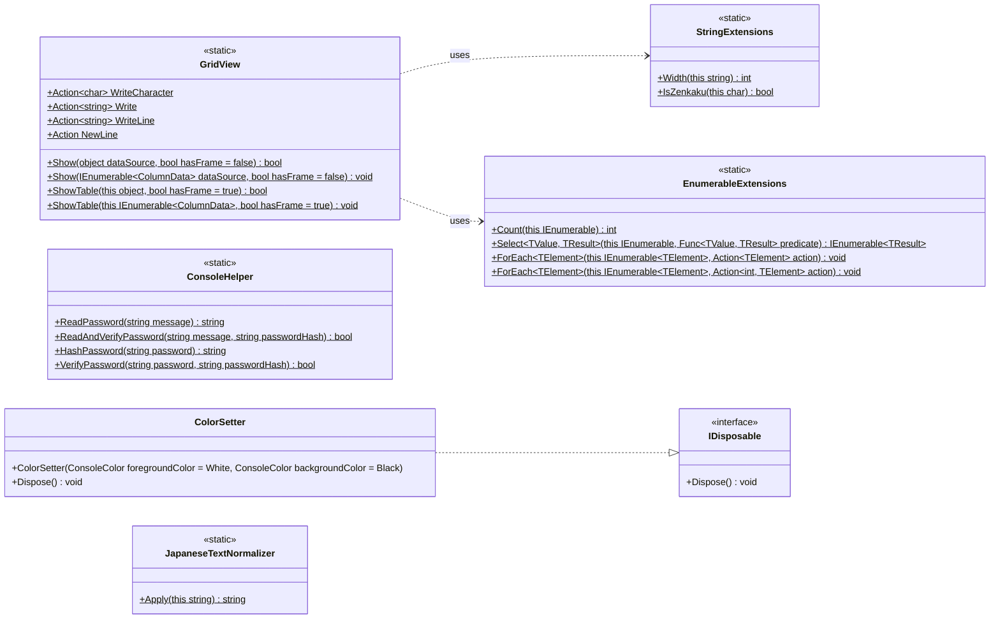

# Shos.Console

[English](https://github.com/Fujiwo/Shos.Console/blob/main/README.md) | [日本語](https://github.com/Fujiwo/Shos.Console/blob/main/README.jp.md)

## 概要

コンソール用ライブラリ (.NET 8.0 / .NET 10.0)

コンソール アプリケーション向けのライブラリです。

* **GridView**: コレクションを表形式でコンソールに表示
* **ConsoleHelper**: コンソールからのパスワード入力と、そのハッシュ化・検証 (ソルト付き PBKDF2-SHA256)
* **ColorSetter**: コンソールの前景色・背景色を一時的に変更
* **JapaneseTextNormalizer**: 日本語テキストの正規化 (全角英数記号・半角カタカナ)
* **StringExtensions** / **EnumerableExtensions**: ライブラリ内部でも使用している拡張メソッド

## 対応フレームワーク

* .NET 8.0 (`net8.0`)
* .NET 10.0 (`net10.0`)

NuGet パッケージには両方のターゲット フレームワーク向けのアセンブリが含まれています。

## NuGet

Visual Studio などから [NuGet](https://www.nuget.org) を使ってプロジェクトに Shos.Console をインストールできます。

* [NuGet Gallery | Shos.Console](https://www.nuget.org/packages/Shos.Console/)

### パッケージ マネージャー

    PM>Install-Package Shos.Console -version 1.1.8

### .NET CLI

    >dotnet add package Shos.Console --version 1.1.8

### PackageReference

    <PackageReference Include="Shos.Console" Version="1.1.8" />

## クラス図

Shos.Console の公開されている型とメンバー (名前空間 `Shos.Console`)。




* `ColumnData` は、カラム名とそのカラムの値を表すタプル `(string colomnName, IEnumerable<object?> values)` です。
* `this` は拡張メソッドであることを示します。

## 使い方

ソース ファイルに `using Shos.Console;` を追加してください。

### GridView

コレクションを表形式でコンソールに表示します。

* 要素の public プロパティがそれぞれカラムになります (インデクサー プロパティは除外)。
* 表示幅を考慮して桁を揃えるため、所謂全角・半角文字が混在していても表が崩れません。
* 数値は右寄せで表示されます。`double` と `float` は小数点以下 1 桁 (`F1`) で表示されます。
* `Show` は既定で枠なし、拡張メソッド `ShowTable` は既定で枠付きで表示します。
* `Show(object)` / `ShowTable(this object)` は、データ ソースがコレクションでない場合、null でない要素がない場合、要素にプロパティがない場合に、何も表示せず `false` を返します。
* カラム名ごとにデータを渡すこともできます (`IEnumerable<(string colomnName, IEnumerable<object?> values)>`)。カラムごとに要素数が異なっていてもよく、足りないセルは空欄になります。
* 出力はデリゲート `WriteCharacter`、`Write`、`WriteLine`、`NewLine` を通して行われます (既定では `System.Console` に出力)。これらを差し替えると出力先を変更できます。

```csharp
var staffs = new[] {
    new { Number = 101, Name = "吉田 拓郎"   , Score =   0.0 },
    new { Number =   9, Name = "Kana Nishino", Score = 100.0 }
};

GridView.Show(staffs);  // 枠なし
staffs.ShowTable();     // 枠付き

(string, IEnumerable<object?>)[] columns = [
    ("Key"  , ["1", "2", "3"]),
    ("Title", ["Search", "Add"])
];
columns.ShowTable();
```

実行結果:

```
Number Name         Score
   101 吉田 拓郎      0.0
     9 Kana Nishino 100.0

+--------+--------------+-------+
| Number | Name         | Score |
+--------+--------------+-------+
|    101 | 吉田 拓郎    |   0.0 |
|      9 | Kana Nishino | 100.0 |
+--------+--------------+-------+

+-----+--------+
| Key | Title  |
+-----+--------+
| 1   | Search |
| 2   | Add    |
| 3   |        |
+-----+--------+
```

### ConsoleHelper

* `public static string ReadPassword(string message)`
    * コンソールからパスワードを入力し (入力文字は `*` で表示)、ソルト付き PBKDF2-SHA256 ハッシュを返します。
    * 入力できる文字は `a-z`、`A-Z`、`0-9`、`!@#$%^&*` のみです。Backspace で 1 文字削除、Enter で入力を終了します。
* `public static bool ReadAndVerifyPassword(string message, string passwordHash)`
    * `ReadPassword` と同じ方法でコンソールからパスワードを入力し、`ReadPassword` または `HashPassword` が返したハッシュと照合します。
* `public static string HashPassword(string password)`
    * コンソールを使わずに、ソルト付き PBKDF2-SHA256 ハッシュを生成します。
* `public static bool VerifyPassword(string password, string passwordHash)`
    * `ReadPassword` または `HashPassword` が返したハッシュとパスワードを照合します。
    * 対応していない形式のハッシュに対しては `false` を返します。

ハッシュの形式は `shos-pbkdf2-sha256$v1$600000$<ソルト (Base64)>$<キー (Base64)>` です。ランダムな 16 バイトのソルトと 600,000 回の反復を使うため、同じパスワードでも毎回異なるハッシュ値になります。パスワードの確認には、ハッシュ同士を比較せず `ReadAndVerifyPassword` または `VerifyPassword` を使ってください。

1.1.6 より前のバージョンが返したハッシュ値 (ソルトなし SHA-256) とは互換性がないため、移行が必要です。

```csharp
// 登録時: パスワードではなくハッシュを保存する
var passwordHash = ConsoleHelper.ReadPassword("Input password");

// ログイン時: コンソールからパスワードを入力して照合する
var ok = ConsoleHelper.ReadAndVerifyPassword("Input password", passwordHash);

// 手元にあるパスワードを照合する場合
var ok2 = ConsoleHelper.VerifyPassword(password, passwordHash);
```

### ColorSetter

コンソールの前景色・背景色を一時的に設定します。`Dispose()` で元の色に戻ります。

```csharp
using (new ColorSetter(foregroundColor: ConsoleColor.Red, backgroundColor: ConsoleColor.Gray)) {
    Console.WriteLine("Red on Gray.");
}
Console.WriteLine("Original colors.");
```

### JapaneseTextNormalizer

拡張メソッド `Apply()` で日本語テキストを正規化します。

* 全角英数記号 (全角スペースを含む) を半角 (ASCII) に変換します (`ＡＢＣ１２３` → `ABC123`)。
* 半角カタカナを全角カタカナに変換します。濁点・半濁点は前の文字と結合して 1 文字にします (`ｶﾞ` → `ガ`、`ﾊﾟ` → `パ`)。
* 波ダッシュ (`〜`)、全角チルダ (`～`)、全角オーバーライン (`￣`) を `~` に変換します。

```csharp
Console.WriteLine("ＡＢＣ１２３　ｶﾞｷﾞｸﾞﾊﾟ～".Apply()); // ABC123 ガギグパ~
```

### StringExtensions

* `public static int Width(this string @this)`: 文字列の表示幅を返します。全角文字は 2、半角文字は 1 として数えます (`"あいう".Width()` は `6`、`"ｱｲｳ".Width()` は `3`)。
* `public static bool IsZenkaku(this char @this)`: 文字が全角かどうかを返します。

### EnumerableExtensions

`IEnumerable` / `IEnumerable<T>` 用の拡張メソッドです。

* `Count(this IEnumerable)`: 非ジェネリックのシーケンスの要素数を数えます。
* `Select<TValue, TResult>(this IEnumerable, Func<TValue, TResult>)`: 非ジェネリックのシーケンスを射影します。
* `ForEach<TElement>(this IEnumerable<TElement>, Action<TElement>)`: 各要素に対してアクションを実行します。
* `ForEach<TElement>(this IEnumerable<TElement>, Action<int, TElement>)`: 各要素に対して、インデックス付きでアクションを実行します。

## プロジェクト構成

### Shos.Console

ライブラリ本体 (.NET 8.0 および .NET 10.0 対応)。

### Shos.Console.Sample

Shos.Console のサンプル (.NET 8.0 および .NET 10.0 対応)。

### Shos.ConsoleTests

Shos.Console のテスト (MSTest、.NET 8.0 および .NET 10.0 対応)。

## ビルドとテスト

.NET 10 SDK が必要です (`net8.0` ターゲットもビルドできます)。
各ターゲット フレームワークでテストを実行するには、対応する .NET ランタイムが必要です。

    >dotnet build Shos.Console.sln
    >dotnet test Shos.Console.sln

特定のフレームワークのみで実行する場合:

    >dotnet test Shos.Console.sln -f net10.0

## リリース ノート

### 1.1.8

* `ConsoleHelper`: コンソールからパスワードを入力してハッシュと照合する `ReadAndVerifyPassword` を追加。
* `ConsoleHelper`: パスワード入力中に Backspace を押したとき、画面上の `*` も消えるように修正。
* パスワードのサンプルを修正。ソルト付きハッシュ同士を比較していたため常に `NG` になっていたのを、2 回目の入力を `ReadAndVerifyPassword` で照合するように変更。

### 1.1.7

* ソース コードを C# 12 の書き方に刷新 (ファイル スコープ名前空間、プライマリ コンストラクター、コレクション式、リスト パターン、ソース生成正規表現)。公開 API に変更はありません。
* サンプルを C# 12 の書き方に更新。
* NuGet パッケージの説明と README (クラス図・使い方) を更新。

### 1.1.6

* .NET 8.0 と .NET 10.0 の両方に対応 (マルチターゲット)。
* `ConsoleHelper`: パスワード ハッシュをソルト付き PBKDF2-SHA256 に変更。`HashPassword` と `VerifyPassword` を追加。
* `GridView`: 入力シーケンスの列挙を 1 回のみに変更、インデクサー プロパティを除外、先頭行が null の場合にも対応。
* `JapaneseTextNormalizer`: 波ダッシュ・全角チルダを `~` に正規化。

## サンプル

サンプル全体: https://github.com/Fujiwo/Shos.Console/blob/main/Shos.Console.Sample/Program.cs

サンプルのうち GridView の部分:

```csharp
namespace Shos.Console.Sample;

using System;

// Japanese (日本語)
static class Program
{
    static void 英数字記号のみの場合()
    {
        var staffs = new[] {
            new { Number = 101, Name = "Takuro Yoshida" , Email = "takuro.y@xxx.com"  , Score =   0.0 },
            new { Number = 111, Name = "Miyuki Nakajima", Email = "m.nakajima@xxx.com", Score =   8.3 },
            new { Number = 120, Name = "Sho Kiryuin"    , Email = "eiichi@xxx.com"    , Score =  99.7 },
            new { Number =   9, Name = "Kana Nishino"   , Email = "kana@xxx.com"      , Score = 100.0 }
        }.OrderBy(staff => staff.Number);

        GridView.Show(dataSource: staffs);
    }

    static void 所謂全角半角混じりの場合()
    {
        var 全社員 = new[] {
            new { 社員番号 = 101, 氏名 = "吉田 拓郎  ", ﾌﾘｶﾞﾅ = "ﾖｼﾀﾞ ﾀｸﾛｳ" , ﾒｰﾙ = "takuro.y@xxx.com"  , 点数 =   0.0 },
            new { 社員番号 = 111, 氏名 = "中島 みゆき", ﾌﾘｶﾞﾅ = "ﾅｶｼﾞﾏ ﾐﾕｷ" , ﾒｰﾙ = "m.nakajima@xxx.com", 点数 =   8.3 },
            new { 社員番号 = 120, 氏名 = "鬼龍院 翔"  , ﾌﾘｶﾞﾅ = "ｷﾘｭｳｲﾝ ｼｮｳ", ﾒｰﾙ = "eiichi@xxx.com"    , 点数 =  99.7 },
            new { 社員番号 =   9, 氏名 = "西野 かな"  , ﾌﾘｶﾞﾅ = "ﾆｼﾉ ｶﾅ"    , ﾒｰﾙ = "kana@xxx.com"      , 点数 = 100.0 }
        }.OrderBy(社員 => 社員.氏名);

        GridView.Show(dataSource: 全社員, hasFrame: true);
    }

    class Staff
    {
        public int Number { get; set; }
        public string FamilyName { get; set; } = "";
        public string GivenName { get; set; } = "";
        public string FullName => $"{FamilyName} {GivenName}";
        public string FamilyNameRuby { get; set; } = "";
        public string GivenNameRuby { get; set; } = "";
        public string FullNameRuby => $"{FamilyNameRuby} {GivenNameRuby}";
        public string Email { get; set; } = "";
    }

    static void クラス利用の場合()
    {
        List<Staff> staffs = [
            new() { Number = 101, FamilyName = "吉田"  , GivenName = "拓郎  ", FamilyNameRuby = "ﾖｼﾀﾞ"  , GivenNameRuby = "ﾀｸﾛｳ", Email = "takuro.y@xxx.com"   },
            new() { Number = 111, FamilyName = "中島"  , GivenName = "みゆき", FamilyNameRuby = "ﾅｶｼﾞﾏ" , GivenNameRuby = "ﾐﾕｷ" , Email = "m.nakajima@xxx.com" },
            new() { Number =  12, FamilyName = "鬼龍院", GivenName = "翔"    , FamilyNameRuby = "ｷﾘｭｳｲﾝ", GivenNameRuby = "ｼｮｳ" , Email = "eiichi@xxx.com"     },
            new() { Number =   9, FamilyName = "西野"  , GivenName = "かな"  , FamilyNameRuby = "ﾆｼﾉ"   , GivenNameRuby = "ｶﾅ"  , Email = "kana@xxx.com"       }
        ];

        var scoreTable = new Dictionary<int, double> {
            { 101, 100.0 },
            { 111,  80.0 },
            {  12,   8.0 },
            {   9,   0.0 }
        };

        GridView.Show(
            dataSource: staffs.OrderBy(staff => staff.Number)
                              .Select(staff => new {
                                  社員番号 = staff.Number,
                                  氏名 = staff.FullName,
                                  ﾌﾘｶﾞﾅ = staff.FullNameRuby,
                                  ﾒｰﾙ = staff.Email,
                                  得点 = scoreTable[staff.Number]
                              }),
            hasFrame: true
        );
    }

    class Department
    {
        public int Code { get; set; }
        public string Name { get; set; } = "";
    }

    class Employee
    {
        public string Name { get; set; } = "";
        public int Number { get; set; }
        public Department? Department { get; set; }
    }

    static void クラスを2つ利用した場合()
    {
        Department[] departments = [
            new() { Code = 1001, Name = "人事部"        },
            new() { Code =  501, Name = "経理部"        },
            new() { Code = 3001, Name = "R&D室"         },
            new() { Code =   27, Name = "土木開発事業部"}
        ];

        Employee[] staffs = [
            new() { Name = "西村 要"    , Number =   3, Department = departments[0] },
            new() { Name = "川村 咲"    , Number = 101, Department = departments[1] },
            new() { Name = "東 さくら"  , Number =  40, Department = departments[1] },
            new() { Name = "柴咲 育三郎", Number =  27, Department = departments[2] }
        ];

        Console.WriteLine("(1) GridView.Show(departments)");

        GridView.Show(dataSource: departments, hasFrame: true);

        Console.WriteLine("(2.1) GridView.Show(staffs)");

        GridView.Show(dataSource: staffs, hasFrame: true);

        Console.WriteLine("(2.2) GridView.Show(staffs.Select(...))");

        GridView.Show(
            dataSource: staffs.Select(staff => new { 名前 = staff.Name, 番号 = staff.Number, 部署 = $"{staff.Department?.Name ?? ""}({staff.Department?.Code})" }),
            hasFrame: true
        );

        Console.WriteLine("(2.3) staffs.Select(...).ShowTable() | Extension method version");

        // Extension method version
        staffs.OrderBy(staff => staff.Number)
              .Select(staff => new { 名前 = staff.Name, 番号 = staff.Number, 部署 = $"{staff.Department?.Name ?? ""}({staff.Department?.Code})" })
              .ShowTable();
    }

    static void カラム名ごとにデータを渡す場合()
    {
        (string, IEnumerable<object?>)[] 全社員 = [
            ("社員番号", [101, 111, 120, 9, 100]),
            ("氏名"   , ["吉田 拓郎", "中島 みゆき", "鬼龍院 翔", "西野 かな"]),
            ("ﾌﾘｶﾞﾅ"   , ["ﾖｼﾀﾞ ﾀｸﾛｳ", "ﾅｶｼﾞﾏ ﾐﾕｷ", "ｷﾘｭｳｲﾝ ｼｮｳ", "ﾆｼﾉ ｶﾅ"]),
            ("ﾒｰﾙ"   , ["takuro.y@xxx.com", "m.nakajima@xxx.com", "eiichi@xxx.com", "kana@xxx.com"]),
        ];

        GridView.Show(dataSource: 全社員, hasFrame: true);
    }

    readonly record struct MenuItem(string Key, string Title)
    {
        public enum Kind { 社員, 部署, その他 };
    }

    static void カラム名ごとにデータを渡す場合応用編()
    {
        (MenuItem, MenuItem.Kind)[] menuItems = [
            (new("1", "検索"), MenuItem.Kind.社員),
            (new("2", "追加"), MenuItem.Kind.社員),
            (new("3", "削除"), MenuItem.Kind.社員),
            (new("4", "変更"), MenuItem.Kind.社員),
            (new("1", "検索"), MenuItem.Kind.部署),
            (new("2", "追加"), MenuItem.Kind.部署),
            (new("3", "削除"), MenuItem.Kind.部署),
            (new("4", "変更"), MenuItem.Kind.部署),
            (new("1", "保存"), MenuItem.Kind.その他),
            (new("2", "終了"), MenuItem.Kind.その他)
        ];

        var groups = menuItems.GroupBy(menuItem => menuItem.Item2);
        var dataSource = groups.Select(group => (group.Key.ToString(), group.Select(menuItem => (object?)$"({menuItem.Item1.Key}){menuItem.Item1.Title}")));
        dataSource.ShowTable(hasFrame: true);
    }

    static void Main()
    {
        Action[] samples = [英数字記号のみの場合, 所謂全角半角混じりの場合, クラス利用の場合, クラスを2つ利用した場合, カラム名ごとにデータを渡す場合, カラム名ごとにデータを渡す場合応用編];
        samples.ForEach((index, test) => {
            Console.WriteLine($"■ Test {index + 1}");
            test();
            Console.WriteLine();
        });
    }
}
```

実行結果 (Test 2 の行の順序は現在のカルチャによって異なります):

```
■ Test 1
Number Name            Email              Score
     9 Kana Nishino    kana@xxx.com       100.0
   101 Takuro Yoshida  takuro.y@xxx.com     0.0
   111 Miyuki Nakajima m.nakajima@xxx.com   8.3
   120 Sho Kiryuin     eiichi@xxx.com      99.7

■ Test 2
+----------+-------------+------------+--------------------+-------+
| 社員番号 | 氏名        | ﾌﾘｶﾞﾅ      | ﾒｰﾙ                | 点数  |
+----------+-------------+------------+--------------------+-------+
|      120 | 鬼龍院 翔   | ｷﾘｭｳｲﾝ ｼｮｳ | eiichi@xxx.com     |  99.7 |
|      101 | 吉田 拓郎   | ﾖｼﾀﾞ ﾀｸﾛｳ  | takuro.y@xxx.com   |   0.0 |
|        9 | 西野 かな   | ﾆｼﾉ ｶﾅ     | kana@xxx.com       | 100.0 |
|      111 | 中島 みゆき | ﾅｶｼﾞﾏ ﾐﾕｷ  | m.nakajima@xxx.com |   8.3 |
+----------+-------------+------------+--------------------+-------+

■ Test 3
+----------+-------------+------------+--------------------+-------+
| 社員番号 | 氏名        | ﾌﾘｶﾞﾅ      | ﾒｰﾙ                | 得点  |
+----------+-------------+------------+--------------------+-------+
|        9 | 西野 かな   | ﾆｼﾉ ｶﾅ     | kana@xxx.com       |   0.0 |
|       12 | 鬼龍院 翔   | ｷﾘｭｳｲﾝ ｼｮｳ | eiichi@xxx.com     |   8.0 |
|      101 | 吉田 拓郎   | ﾖｼﾀﾞ ﾀｸﾛｳ  | takuro.y@xxx.com   | 100.0 |
|      111 | 中島 みゆき | ﾅｶｼﾞﾏ ﾐﾕｷ  | m.nakajima@xxx.com |  80.0 |
+----------+-------------+------------+--------------------+-------+

■ Test 4
(1) GridView.Show(departments)
+------+----------------+
| Code | Name           |
+------+----------------+
| 1001 | 人事部         |
|  501 | 経理部         |
| 3001 | R&D室          |
|   27 | 土木開発事業部 |
+------+----------------+
(2.1) GridView.Show(staffs)
+-------------+--------+----------------------------------------+
| Name        | Number | Department                             |
+-------------+--------+----------------------------------------+
| 西村 要     |      3 | Shos.Console.Sample.Program+Department |
| 川村 咲     |    101 | Shos.Console.Sample.Program+Department |
| 東 さくら   |     40 | Shos.Console.Sample.Program+Department |
| 柴咲 育三郎 |     27 | Shos.Console.Sample.Program+Department |
+-------------+--------+----------------------------------------+
(2.2) GridView.Show(staffs.Select(...))
+-------------+------+--------------+
| 名前        | 番号 | 部署         |
+-------------+------+--------------+
| 西村 要     |    3 | 人事部(1001) |
| 川村 咲     |  101 | 経理部(501)  |
| 東 さくら   |   40 | 経理部(501)  |
| 柴咲 育三郎 |   27 | R&D室(3001)  |
+-------------+------+--------------+
(2.3) staffs.Select(...).ShowTable() | Extension method version
+-------------+------+--------------+
| 名前        | 番号 | 部署         |
+-------------+------+--------------+
| 西村 要     |    3 | 人事部(1001) |
| 柴咲 育三郎 |   27 | R&D室(3001)  |
| 東 さくら   |   40 | 経理部(501)  |
| 川村 咲     |  101 | 経理部(501)  |
+-------------+------+--------------+

■ Test 5
+----------+-------------+------------+--------------------+
| 社員番号 | 氏名        | ﾌﾘｶﾞﾅ      | ﾒｰﾙ                |
+----------+-------------+------------+--------------------+
|      101 | 吉田 拓郎   | ﾖｼﾀﾞ ﾀｸﾛｳ  | takuro.y@xxx.com   |
|      111 | 中島 みゆき | ﾅｶｼﾞﾏ ﾐﾕｷ  | m.nakajima@xxx.com |
|      120 | 鬼龍院 翔   | ｷﾘｭｳｲﾝ ｼｮｳ | eiichi@xxx.com     |
|        9 | 西野 かな   | ﾆｼﾉ ｶﾅ     | kana@xxx.com       |
|      100 |             |            |                    |
+----------+-------------+------------+--------------------+

■ Test 6
+---------+---------+---------+
| 社員    | 部署    | その他  |
+---------+---------+---------+
| (1)検索 | (1)検索 | (1)保存 |
| (2)追加 | (2)追加 | (2)終了 |
| (3)削除 | (3)削除 |         |
| (4)変更 | (4)変更 |         |
+---------+---------+---------+
```

## 作者情報

Fujio Kojima: 日本のソフトウェア開発者
* Microsoft MVP for Development Tools - Visual C# (2005年7月 - 2014年12月)
* Microsoft MVP for .NET (2015年1月 - 2015年10月)
* Microsoft MVP for Visual Studio and Development Technologies (2015年11月 - 2018年6月)
* Microsoft MVP for Developer Technologies (2018年11月 - 2027年6月)
* [MVP Profile](https://mvp.microsoft.com/en-us/PublicProfile/21482 "MVP Profile")
* [ブログ](http://wp.shos.info "ブログ")
* [Web サイト](http://www.shos.info "Web サイト")
* [Twitter](https://twitter.com/Fujiwo)
* [Instagram](https://www.instagram.com/fujiwo/)

## ライセンス

このライブラリは MIT ライセンスの下で提供されています。
