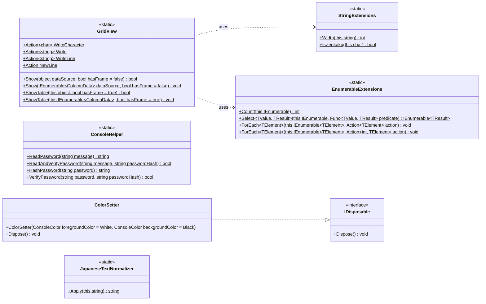

# Shos.Console

[English](https://github.com/Fujiwo/Shos.Console/blob/main/README.md) | [日本語](https://github.com/Fujiwo/Shos.Console/blob/main/README.jp.md)

## Summary

Console Library (.NET 8.0 / .NET 10.0)

A library for console applications.

* **GridView**: Draw a collection as a table to the console
* **ConsoleHelper**: Read a password from the console and hash/verify it (salted PBKDF2-SHA256)
* **ColorSetter**: Temporarily set the console foreground and background colors
* **JapaneseTextNormalizer**: Normalize Japanese text (full-width ASCII and half-width katakana)
* **StringExtensions** / **EnumerableExtensions**: Helper extension methods used by the library

## Supported Frameworks

* .NET 8.0 (`net8.0`)
* .NET 10.0 (`net10.0`)

The NuGet package contains assemblies for both target frameworks.

## NuGet

You can install Shos.Console in your project with [NuGet](https://www.nuget.org), for example from Visual Studio.

* [NuGet Gallery | Shos.Console](https://www.nuget.org/packages/Shos.Console/)

### Package Manager

    PM>Install-Package Shos.Console -version 1.1.8

### .NET CLI

    >dotnet add package Shos.Console --version 1.1.8

### PackageReference

    <PackageReference Include="Shos.Console" Version="1.1.8" />

## Class Diagram

Public types and members of Shos.Console (namespace `Shos.Console`).



* `ColumnData` stands for the tuple `(string colomnName, IEnumerable<object?> values)`: a column name and the values in that column.
* `this` marks an extension method.

## Usage

Add `using Shos.Console;` to your source file.

### GridView

Draws a collection as a table to the console.

* Each public property of the elements becomes a column (indexer properties are skipped).
* Aligns columns by display width, so full-width (全角) and half-width (半角) characters can be mixed.
* Numbers are right-aligned. `double` and `float` values are formatted with one decimal place (`F1`).
* `Show` draws without a frame by default. The `ShowTable` extension methods draw with a frame by default.
* `Show(object)` / `ShowTable(this object)` return `false` and draw nothing when the data source is not a collection, has no non-null elements, or its elements have no properties.
* Data can also be passed per column as `IEnumerable<(string colomnName, IEnumerable<object?> values)>`. Columns may have different lengths. Missing cells are left blank.
* Output goes through the `WriteCharacter`, `Write`, `WriteLine` and `NewLine` delegates, which write to `System.Console` by default. Replace them to redirect the output.

```csharp
var staffs = new[] {
    new { Number = 101, Name = "吉田 拓郎"   , Score =   0.0 },
    new { Number =   9, Name = "Kana Nishino", Score = 100.0 }
};

GridView.Show(staffs);  // without frame
staffs.ShowTable();     // with frame

(string, IEnumerable<object?>)[] columns = [
    ("Key"  , ["1", "2", "3"]),
    ("Title", ["Search", "Add"])
];
columns.ShowTable();
```

Result:

```
Number Name         Score
   101 吉田 拓郎      0.0
     9 Kana Nishino 100.0

+--------+--------------+-------+
| Number | Name         | Score |
+--------+--------------+-------+
|    101 | 吉田 拓郎    |   0.0 |
|      9 | Kana Nishino | 100.0 |
+--------+--------------+-------+

+-----+--------+
| Key | Title  |
+-----+--------+
| 1   | Search |
| 2   | Add    |
| 3   |        |
+-----+--------+
```

### ConsoleHelper

* `public static string ReadPassword(string message)`
    * Reads a password from the console input (shown as `*`) and returns a salted PBKDF2-SHA256 hash.
    * Only `a-z`, `A-Z`, `0-9` and `!@#$%^&*` are accepted. Backspace deletes the last character, and Enter ends the input.
* `public static bool ReadAndVerifyPassword(string message, string passwordHash)`
    * Reads a password from the console input in the same way as `ReadPassword` and verifies it against a hash returned by `ReadPassword` or `HashPassword`.
* `public static string HashPassword(string password)`
    * Creates a salted PBKDF2-SHA256 hash without reading from the console.
* `public static bool VerifyPassword(string password, string passwordHash)`
    * Verifies a password against a hash returned by `ReadPassword` or `HashPassword`.
    * Returns `false` for a hash in an unsupported format.

A hash has the format `shos-pbkdf2-sha256$v1$600000$<salt (Base64)>$<key (Base64)>`. It uses a random 16-byte salt and 600,000 iterations, so hashing the same password twice gives different values. Use `ReadAndVerifyPassword` or `VerifyPassword` to check a password. Do not compare two hashes.

Hash values returned by versions earlier than 1.1.6 (unsalted SHA-256) are not compatible and must be migrated.

```csharp
// Registration: store the hash, not the password.
var passwordHash = ConsoleHelper.ReadPassword("Input password");

// Login: read the password from the console and verify it.
var ok = ConsoleHelper.ReadAndVerifyPassword("Input password", passwordHash);

// Or verify a password you already have.
var ok2 = ConsoleHelper.VerifyPassword(password, passwordHash);
```

### ColorSetter

Temporarily sets the console foreground and background colors. The original colors are restored by `Dispose()`.

```csharp
using (new ColorSetter(foregroundColor: ConsoleColor.Red, backgroundColor: ConsoleColor.Gray)) {
    Console.WriteLine("Red on Gray.");
}
Console.WriteLine("Original colors.");
```

### JapaneseTextNormalizer

`Apply()` is an extension method that normalizes Japanese text:

* Full-width ASCII characters (including the full-width space) are converted to ASCII (`ＡＢＣ１２３` → `ABC123`).
* Half-width katakana are converted to full-width katakana. A dakuten or handakuten after a kana is combined into one character (`ｶﾞ` → `ガ`, `ﾊﾟ` → `パ`).
* Wave dash (`〜`), full-width tilde (`～`) and full-width macron (`￣`) are converted to `~`.

```csharp
Console.WriteLine("ＡＢＣ１２３　ｶﾞｷﾞｸﾞﾊﾟ～".Apply()); // ABC123 ガギグパ~
```

### StringExtensions

* `public static int Width(this string @this)`: The display width of a string, counting full-width characters as 2 and half-width characters as 1 (`"あいう".Width()` is `6`, `"ｱｲｳ".Width()` is `3`).
* `public static bool IsZenkaku(this char @this)`: Whether a character is full-width.

### EnumerableExtensions

Extension methods for `IEnumerable` and `IEnumerable<T>`:

* `Count(this IEnumerable)`: Counts the elements of a non-generic sequence.
* `Select<TValue, TResult>(this IEnumerable, Func<TValue, TResult>)`: Projects a non-generic sequence.
* `ForEach<TElement>(this IEnumerable<TElement>, Action<TElement>)`: Runs an action for each element.
* `ForEach<TElement>(this IEnumerable<TElement>, Action<int, TElement>)`: Runs an action for each element, with its index.

## Projects

### Shos.Console

Library (targets .NET 8.0 and .NET 10.0).

### Shos.Console.Sample

Sample for Shos.Console (targets .NET 8.0 and .NET 10.0).

### Shos.ConsoleTests

Tests for Shos.Console (MSTest, targets .NET 8.0 and .NET 10.0).

## Build and Test

Requires the .NET 10 SDK, which can also build the `net8.0` targets.
Running the tests for each target framework requires the corresponding .NET runtime.

    >dotnet build Shos.Console.sln
    >dotnet test Shos.Console.sln

To run for a specific framework:

    >dotnet test Shos.Console.sln -f net10.0

## Release Notes

### 1.1.8

* `ConsoleHelper`: Added `ReadAndVerifyPassword`, which reads a password from the console and verifies it against a hash.
* `ConsoleHelper`: Backspace during password input now also erases the `*` on the screen.
* Fixed the password sample, which compared two salted hashes and therefore always printed `NG`. It now verifies the second input with `ReadAndVerifyPassword`.

### 1.1.7

* Modernized the source code to C# 12 (file-scoped namespaces, primary constructors, collection expressions, list patterns and source-generated regular expressions). The public API has not changed.
* Updated the sample to C# 12.
* Updated the NuGet package description and this README (class diagram and usage).

### 1.1.6

* Supports both .NET 8.0 and .NET 10.0 (multi-targeting).
* `ConsoleHelper`: Password hashes use salted PBKDF2-SHA256. Added `HashPassword` and `VerifyPassword`.
* `GridView`: Enumerates each input sequence only once, skips indexer properties, and tolerates a null first row.
* `JapaneseTextNormalizer`: Normalizes the wave dash and the full-width tilde to `~`.

## Sample

Full sample: https://github.com/Fujiwo/Shos.Console/blob/main/Shos.Console.Sample/Program.cs

GridView part of the sample:

```csharp
namespace Shos.Console.Sample;

using System;

// Japanese (日本語)
static class Program
{
    static void 英数字記号のみの場合()
    {
        var staffs = new[] {
            new { Number = 101, Name = "Takuro Yoshida" , Email = "takuro.y@xxx.com"  , Score =   0.0 },
            new { Number = 111, Name = "Miyuki Nakajima", Email = "m.nakajima@xxx.com", Score =   8.3 },
            new { Number = 120, Name = "Sho Kiryuin"    , Email = "eiichi@xxx.com"    , Score =  99.7 },
            new { Number =   9, Name = "Kana Nishino"   , Email = "kana@xxx.com"      , Score = 100.0 }
        }.OrderBy(staff => staff.Number);

        GridView.Show(dataSource: staffs);
    }

    static void 所謂全角半角混じりの場合()
    {
        var 全社員 = new[] {
            new { 社員番号 = 101, 氏名 = "吉田 拓郎  ", ﾌﾘｶﾞﾅ = "ﾖｼﾀﾞ ﾀｸﾛｳ" , ﾒｰﾙ = "takuro.y@xxx.com"  , 点数 =   0.0 },
            new { 社員番号 = 111, 氏名 = "中島 みゆき", ﾌﾘｶﾞﾅ = "ﾅｶｼﾞﾏ ﾐﾕｷ" , ﾒｰﾙ = "m.nakajima@xxx.com", 点数 =   8.3 },
            new { 社員番号 = 120, 氏名 = "鬼龍院 翔"  , ﾌﾘｶﾞﾅ = "ｷﾘｭｳｲﾝ ｼｮｳ", ﾒｰﾙ = "eiichi@xxx.com"    , 点数 =  99.7 },
            new { 社員番号 =   9, 氏名 = "西野 かな"  , ﾌﾘｶﾞﾅ = "ﾆｼﾉ ｶﾅ"    , ﾒｰﾙ = "kana@xxx.com"      , 点数 = 100.0 }
        }.OrderBy(社員 => 社員.氏名);

        GridView.Show(dataSource: 全社員, hasFrame: true);
    }

    class Staff
    {
        public int Number { get; set; }
        public string FamilyName { get; set; } = "";
        public string GivenName { get; set; } = "";
        public string FullName => $"{FamilyName} {GivenName}";
        public string FamilyNameRuby { get; set; } = "";
        public string GivenNameRuby { get; set; } = "";
        public string FullNameRuby => $"{FamilyNameRuby} {GivenNameRuby}";
        public string Email { get; set; } = "";
    }

    static void クラス利用の場合()
    {
        List<Staff> staffs = [
            new() { Number = 101, FamilyName = "吉田"  , GivenName = "拓郎  ", FamilyNameRuby = "ﾖｼﾀﾞ"  , GivenNameRuby = "ﾀｸﾛｳ", Email = "takuro.y@xxx.com"   },
            new() { Number = 111, FamilyName = "中島"  , GivenName = "みゆき", FamilyNameRuby = "ﾅｶｼﾞﾏ" , GivenNameRuby = "ﾐﾕｷ" , Email = "m.nakajima@xxx.com" },
            new() { Number =  12, FamilyName = "鬼龍院", GivenName = "翔"    , FamilyNameRuby = "ｷﾘｭｳｲﾝ", GivenNameRuby = "ｼｮｳ" , Email = "eiichi@xxx.com"     },
            new() { Number =   9, FamilyName = "西野"  , GivenName = "かな"  , FamilyNameRuby = "ﾆｼﾉ"   , GivenNameRuby = "ｶﾅ"  , Email = "kana@xxx.com"       }
        ];

        var scoreTable = new Dictionary<int, double> {
            { 101, 100.0 },
            { 111,  80.0 },
            {  12,   8.0 },
            {   9,   0.0 }
        };

        GridView.Show(
            dataSource: staffs.OrderBy(staff => staff.Number)
                              .Select(staff => new {
                                  社員番号 = staff.Number,
                                  氏名 = staff.FullName,
                                  ﾌﾘｶﾞﾅ = staff.FullNameRuby,
                                  ﾒｰﾙ = staff.Email,
                                  得点 = scoreTable[staff.Number]
                              }),
            hasFrame: true
        );
    }

    class Department
    {
        public int Code { get; set; }
        public string Name { get; set; } = "";
    }

    class Employee
    {
        public string Name { get; set; } = "";
        public int Number { get; set; }
        public Department? Department { get; set; }
    }

    static void クラスを2つ利用した場合()
    {
        Department[] departments = [
            new() { Code = 1001, Name = "人事部"        },
            new() { Code =  501, Name = "経理部"        },
            new() { Code = 3001, Name = "R&D室"         },
            new() { Code =   27, Name = "土木開発事業部"}
        ];

        Employee[] staffs = [
            new() { Name = "西村 要"    , Number =   3, Department = departments[0] },
            new() { Name = "川村 咲"    , Number = 101, Department = departments[1] },
            new() { Name = "東 さくら"  , Number =  40, Department = departments[1] },
            new() { Name = "柴咲 育三郎", Number =  27, Department = departments[2] }
        ];

        Console.WriteLine("(1) GridView.Show(departments)");

        GridView.Show(dataSource: departments, hasFrame: true);

        Console.WriteLine("(2.1) GridView.Show(staffs)");

        GridView.Show(dataSource: staffs, hasFrame: true);

        Console.WriteLine("(2.2) GridView.Show(staffs.Select(...))");

        GridView.Show(
            dataSource: staffs.Select(staff => new { 名前 = staff.Name, 番号 = staff.Number, 部署 = $"{staff.Department?.Name ?? ""}({staff.Department?.Code})" }),
            hasFrame: true
        );

        Console.WriteLine("(2.3) staffs.Select(...).ShowTable() | Extension method version");

        // Extension method version
        staffs.OrderBy(staff => staff.Number)
              .Select(staff => new { 名前 = staff.Name, 番号 = staff.Number, 部署 = $"{staff.Department?.Name ?? ""}({staff.Department?.Code})" })
              .ShowTable();
    }

    static void カラム名ごとにデータを渡す場合()
    {
        (string, IEnumerable<object?>)[] 全社員 = [
            ("社員番号", [101, 111, 120, 9, 100]),
            ("氏名"   , ["吉田 拓郎", "中島 みゆき", "鬼龍院 翔", "西野 かな"]),
            ("ﾌﾘｶﾞﾅ"   , ["ﾖｼﾀﾞ ﾀｸﾛｳ", "ﾅｶｼﾞﾏ ﾐﾕｷ", "ｷﾘｭｳｲﾝ ｼｮｳ", "ﾆｼﾉ ｶﾅ"]),
            ("ﾒｰﾙ"   , ["takuro.y@xxx.com", "m.nakajima@xxx.com", "eiichi@xxx.com", "kana@xxx.com"]),
        ];

        GridView.Show(dataSource: 全社員, hasFrame: true);
    }

    readonly record struct MenuItem(string Key, string Title)
    {
        public enum Kind { 社員, 部署, その他 };
    }

    static void カラム名ごとにデータを渡す場合応用編()
    {
        (MenuItem, MenuItem.Kind)[] menuItems = [
            (new("1", "検索"), MenuItem.Kind.社員),
            (new("2", "追加"), MenuItem.Kind.社員),
            (new("3", "削除"), MenuItem.Kind.社員),
            (new("4", "変更"), MenuItem.Kind.社員),
            (new("1", "検索"), MenuItem.Kind.部署),
            (new("2", "追加"), MenuItem.Kind.部署),
            (new("3", "削除"), MenuItem.Kind.部署),
            (new("4", "変更"), MenuItem.Kind.部署),
            (new("1", "保存"), MenuItem.Kind.その他),
            (new("2", "終了"), MenuItem.Kind.その他)
        ];

        var groups = menuItems.GroupBy(menuItem => menuItem.Item2);
        var dataSource = groups.Select(group => (group.Key.ToString(), group.Select(menuItem => (object?)$"({menuItem.Item1.Key}){menuItem.Item1.Title}")));
        dataSource.ShowTable(hasFrame: true);
    }

    static void Main()
    {
        Action[] samples = [英数字記号のみの場合, 所謂全角半角混じりの場合, クラス利用の場合, クラスを2つ利用した場合, カラム名ごとにデータを渡す場合, カラム名ごとにデータを渡す場合応用編];
        samples.ForEach((index, test) => {
            Console.WriteLine($"■ Test {index + 1}");
            test();
            Console.WriteLine();
        });
    }
}
```

Result (the row order of Test 2 depends on the current culture):

```
■ Test 1
Number Name            Email              Score
     9 Kana Nishino    kana@xxx.com       100.0
   101 Takuro Yoshida  takuro.y@xxx.com     0.0
   111 Miyuki Nakajima m.nakajima@xxx.com   8.3
   120 Sho Kiryuin     eiichi@xxx.com      99.7

■ Test 2
+----------+-------------+------------+--------------------+-------+
| 社員番号 | 氏名        | ﾌﾘｶﾞﾅ      | ﾒｰﾙ                | 点数  |
+----------+-------------+------------+--------------------+-------+
|      120 | 鬼龍院 翔   | ｷﾘｭｳｲﾝ ｼｮｳ | eiichi@xxx.com     |  99.7 |
|      101 | 吉田 拓郎   | ﾖｼﾀﾞ ﾀｸﾛｳ  | takuro.y@xxx.com   |   0.0 |
|        9 | 西野 かな   | ﾆｼﾉ ｶﾅ     | kana@xxx.com       | 100.0 |
|      111 | 中島 みゆき | ﾅｶｼﾞﾏ ﾐﾕｷ  | m.nakajima@xxx.com |   8.3 |
+----------+-------------+------------+--------------------+-------+

■ Test 3
+----------+-------------+------------+--------------------+-------+
| 社員番号 | 氏名        | ﾌﾘｶﾞﾅ      | ﾒｰﾙ                | 得点  |
+----------+-------------+------------+--------------------+-------+
|        9 | 西野 かな   | ﾆｼﾉ ｶﾅ     | kana@xxx.com       |   0.0 |
|       12 | 鬼龍院 翔   | ｷﾘｭｳｲﾝ ｼｮｳ | eiichi@xxx.com     |   8.0 |
|      101 | 吉田 拓郎   | ﾖｼﾀﾞ ﾀｸﾛｳ  | takuro.y@xxx.com   | 100.0 |
|      111 | 中島 みゆき | ﾅｶｼﾞﾏ ﾐﾕｷ  | m.nakajima@xxx.com |  80.0 |
+----------+-------------+------------+--------------------+-------+

■ Test 4
(1) GridView.Show(departments)
+------+----------------+
| Code | Name           |
+------+----------------+
| 1001 | 人事部         |
|  501 | 経理部         |
| 3001 | R&D室          |
|   27 | 土木開発事業部 |
+------+----------------+
(2.1) GridView.Show(staffs)
+-------------+--------+----------------------------------------+
| Name        | Number | Department                             |
+-------------+--------+----------------------------------------+
| 西村 要     |      3 | Shos.Console.Sample.Program+Department |
| 川村 咲     |    101 | Shos.Console.Sample.Program+Department |
| 東 さくら   |     40 | Shos.Console.Sample.Program+Department |
| 柴咲 育三郎 |     27 | Shos.Console.Sample.Program+Department |
+-------------+--------+----------------------------------------+
(2.2) GridView.Show(staffs.Select(...))
+-------------+------+--------------+
| 名前        | 番号 | 部署         |
+-------------+------+--------------+
| 西村 要     |    3 | 人事部(1001) |
| 川村 咲     |  101 | 経理部(501)  |
| 東 さくら   |   40 | 経理部(501)  |
| 柴咲 育三郎 |   27 | R&D室(3001)  |
+-------------+------+--------------+
(2.3) staffs.Select(...).ShowTable() | Extension method version
+-------------+------+--------------+
| 名前        | 番号 | 部署         |
+-------------+------+--------------+
| 西村 要     |    3 | 人事部(1001) |
| 柴咲 育三郎 |   27 | R&D室(3001)  |
| 東 さくら   |   40 | 経理部(501)  |
| 川村 咲     |  101 | 経理部(501)  |
+-------------+------+--------------+

■ Test 5
+----------+-------------+------------+--------------------+
| 社員番号 | 氏名        | ﾌﾘｶﾞﾅ      | ﾒｰﾙ                |
+----------+-------------+------------+--------------------+
|      101 | 吉田 拓郎   | ﾖｼﾀﾞ ﾀｸﾛｳ  | takuro.y@xxx.com   |
|      111 | 中島 みゆき | ﾅｶｼﾞﾏ ﾐﾕｷ  | m.nakajima@xxx.com |
|      120 | 鬼龍院 翔   | ｷﾘｭｳｲﾝ ｼｮｳ | eiichi@xxx.com     |
|        9 | 西野 かな   | ﾆｼﾉ ｶﾅ     | kana@xxx.com       |
|      100 |             |            |                    |
+----------+-------------+------------+--------------------+

■ Test 6
+---------+---------+---------+
| 社員    | 部署    | その他  |
+---------+---------+---------+
| (1)検索 | (1)検索 | (1)保存 |
| (2)追加 | (2)追加 | (2)終了 |
| (3)削除 | (3)削除 |         |
| (4)変更 | (4)変更 |         |
+---------+---------+---------+
```

## Author Info

Fujio Kojima: a software developer in Japan
* Microsoft MVP for Development Tools - Visual C# (Jul. 2005 - Dec. 2014)
* Microsoft MVP for .NET (Jan. 2015 - Oct. 2015)
* Microsoft MVP for Visual Studio and Development Technologies (Nov. 2015 - Jun. 2018)
* Microsoft MVP for Developer Technologies (Nov. 2018 - Jun. 2027)
* [MVP Profile](https://mvp.microsoft.com/en-us/PublicProfile/21482 "MVP Profile")
* [Blog (Japanese)](http://wp.shos.info "Blog (Japanese)")
* [Web Site (Japanese)](http://www.shos.info "Web Site (Japanese)")
* [Twitter](https://twitter.com/Fujiwo)
* [Instagram](https://www.instagram.com/fujiwo/)

## License

This library is under the MIT License.
